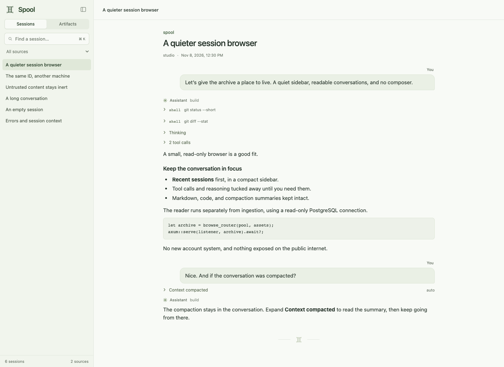

<p align="center">
  
</p>

<h1 align="center">Spool</h1>

<p align="center">
  <b>Every coding-agent session, from every machine, in one place.</b><br>
  An archive your agents can search, and you can read.
</p>

<p align="center">
  
</p>

Agent sessions pile up on whichever laptop they ran on, then vanish. Spool
captures them from [OpenCode](https://opencode.ai) as they happen and keeps
them on a server you run.

- **Archive.** Sessions from all your machines, grouped by repository, kept
  even after they're deleted locally.
- **Recall.** Agents search and read past sessions with native tools, so
  "what did we decide last week?" has an answer.
- **Read.** A quiet web reader, with links straight to a single message.
- **Publish.** Agents hand you plans, reports and charts as artifacts with
  stable links, instead of walls of chat.
- **Steer.** Message any session on an online machine, from the reader or
  from another agent.

## How it fits together

```text
OpenCode + plugin ──▶ Spool server ──▶ reader
  (each machine)     Rust · Postgres   (your browser)
```

One Rust service and one PostgreSQL database. No model calls.

## Get started

1. [Deploy the server](docs/deployment.md).
2. Connect each machine:

   ```sh
   bun run install-plugin --url https://spool.example.com --source-alias work-laptop
   ```

   It prints a code; approve it in the reader, and capture starts.

More in [client setup](docs/client-setup.md) and
[local development](docs/development.md).
